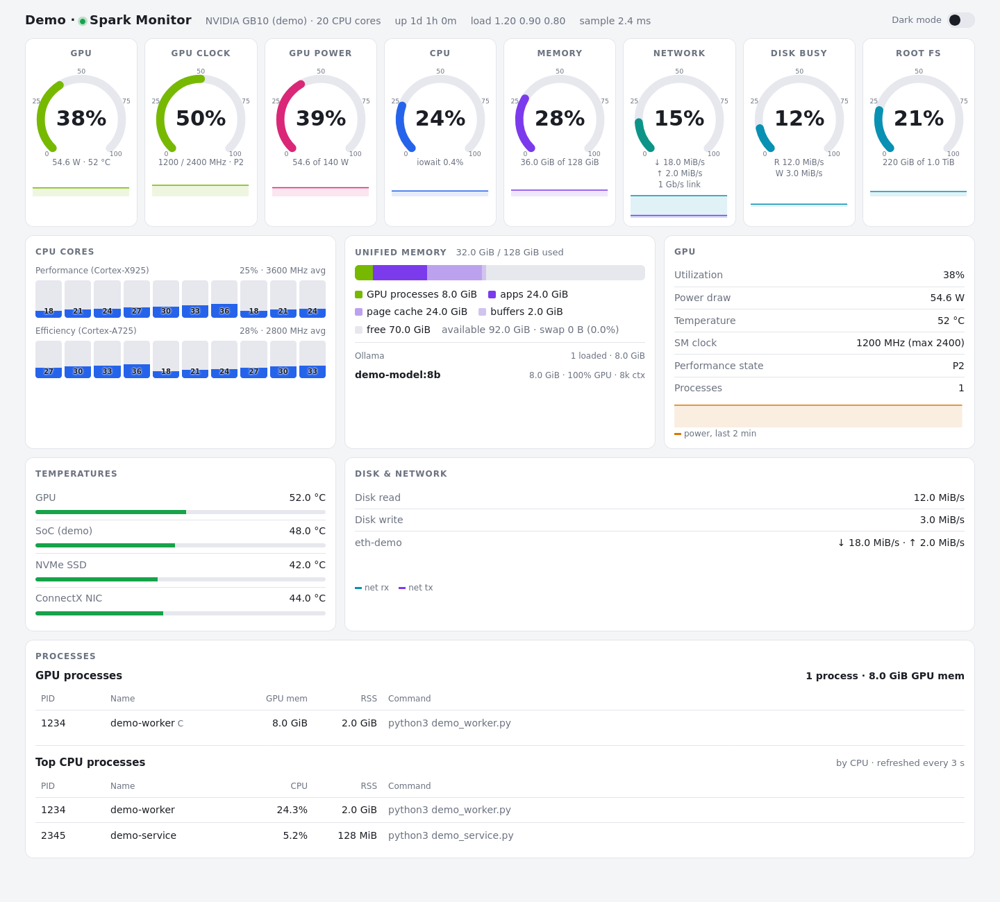

# Spark Monitor

A lightweight, live resource dashboard for an **NVIDIA DGX Spark (GB10)**.
One Python process collects Linux and NVIDIA metrics and streams them to a
self-contained browser interface. No pip packages, frontend dependencies,
external fonts, database, or build step are required.

## Features

- Eight animated gauges: GPU utilization, GPU clock, GPU power, CPU,
  unified memory, network utilization, disk busy, and root filesystem usage.
- Per-core utilization and clocks, grouped by maximum frequency into
  Cortex-X925 performance and Cortex-A725 efficiency clusters.
- Shared-memory breakdown for GPU processes, applications, page cache,
  buffers, free memory, and swap.
- GPU utilization, temperature, power, SM clock, P-state, and compute/graphics
  process allocations through NVML, without spawning `nvidia-smi` per sample.
- Disk throughput, active physical network interfaces, GPU/SoC/NVMe/ConnectX
  temperatures, load averages, uptime, and the top eight CPU processes.
- Optional Ollama integration: loaded models, memory size, GPU share,
  context length, and unload time.
- Light/dark themes with a saved browser preference, responsive cards,
  scrollable process tables, and 120-sample sparklines.
- On-demand sampling: the sampler waits without clients; hidden tabs close
  their stream. Process scans and Ollama polling run at most once per three seconds.



*Illustration uses fabricated metrics, model names, and process information;
no live machine records or credentials are included.*

## Stack and architecture

| Component | Implementation |
| --- | --- |
| Backend | Python 3 standard library; `ThreadingHTTPServer` |
| GPU collector | `ctypes` bindings to the installed `libnvidia-ml.so.1` |
| Linux collectors | Read-only access to `/proc`, `/sys`, and filesystem statistics |
| Transport | Server-Sent Events (SSE), JSON at `/stream` |
| Frontend | Plain HTML, CSS, JavaScript, and inline SVG in `index.html` |
| Optional integration | Ollama HTTP `GET /api/ps` |
| Background service | systemd user service |
| Existing HTTPS | External Caddy reverse proxy managed with the local MyApps setup |

`Sampler` owns one GPU collector, one system collector, and one Ollama
collector. A daemon thread produces a shared JSON snapshot while clients are
connected; a condition variable distributes updates to SSE request threads.
The frontend uses `EventSource`, renders the snapshot, and retains only a
rolling history in the browser. The backend does not persist samples.

Files:

```text
server.py                              collectors, sampler, CLI, HTTP/SSE
index.html                             complete browser application
spark-monitor.service                  original deployment unit
examples/spark-monitor.service.example portable unit with path placeholder
examples/Caddyfile.example             optional HTTPS example
```

## Requirements and credentials

- Linux with readable `/proc` and `/sys`; Python **3.12 is verified**.
- NVIDIA driver and its NVML shared library for GPU data. No NVIDIA Python
  package or CUDA toolkit is required by this app.
- A modern browser supporting SSE, SVG, CSS Grid, and `color-mix()`.
- Optional Ollama server; the default endpoint is `http://127.0.0.1:11434`.
- Optional systemd and Caddy for service management and HTTPS.

**The app needs no API keys, passwords, tokens, or database credentials.**
It has no login or authorization layer. Anyone who can reach the listener can
see machine metrics, process names and command lines, and loaded model names.
Use localhost, a trusted LAN, or an appropriately protected reverse proxy.
HTTPS encrypts traffic but does not add authentication. TLS keys and CA material
belong outside this repository.

## Install and run

```bash
git clone https://github.com/iloromero/spark-monitor.git
cd spark-monitor
python3 server.py --help
python3 server.py
```

Open `http://127.0.0.1:8765`. The private repository requires GitHub access to
clone; use GitHub's secure sign-in or your configured Git credentials.
There is no dependency installation or compilation step.

To serve on a trusted LAN, choose an available port:

```bash
python3 server.py --host 0.0.0.0 --port 8765 --interval 2
```

Do not start a second process on a port already used by the existing service.
Stop a foreground process with Ctrl+C.

### Configuration

All settings are CLI arguments. **The app does not load `.env` files.**
The examples contain placeholders and local addresses, never credentials.

| Argument | Default | Purpose |
| --- | --- | --- |
| `--host` | `127.0.0.1` | Listener address; `0.0.0.0` exposes all IPv4 interfaces |
| `--port` | `8765` | HTTP port |
| `--interval` | `1.0` | Seconds between samples; use a positive value |
| `--ollama` | `http://127.0.0.1:11434` | Ollama base URL; `/api/ps` is appended |
| `--power-max` | `140.0` | Gauge scale in watts if NVML reports no enforced limit |

For an Ollama server on another trusted host, replace `OLLAMA_HOSTNAME`:

```bash
python3 server.py --ollama http://OLLAMA_HOSTNAME:11434 --power-max 140
```

Ollama requests have a 0.5-second timeout and run at most every three seconds.
A stopped Ollama is displayed as “not reachable”; monitoring continues.

## Existing deployment, HTTPS, and schedules

The original machine already runs `spark-monitor.service` as a systemd **user**
service. The checked-in original unit starts:

```text
/usr/bin/python3 %h/Projects/spark-monitor/server.py --host 0.0.0.0 --port 8888
```

It uses `Nice=10`, restarts on failure, and is enabled through the user's
default target. The source location is significant because the unit references
it directly; publishing this repository does not relocate the application.

Existing endpoints, with the actual hostname deliberately omitted:

| Route | Existing behavior |
| --- | --- |
| `http://MONITOR_HOSTNAME:8888` | Direct Python HTTP listener |
| `https://MONITOR_HOSTNAME:18888` | Caddy proxy to `127.0.0.1:8888` |

Caddy runs separately as part of the local MyApps deployment and uses a private
LAN certificate authority. Client devices must trust that CA. The live proxy
configuration, host inventory, certificates, private keys, and MyApps files are
outside this repository. The standalone [Caddy example](examples/Caddyfile.example)
illustrates a fresh deployment; it is not a copy of the active proxy configuration.

No Spark Monitor cron entry or systemd timer was found during publication.
Sampling is driven by connected browsers, not a scheduler. Repository publication
requires no service restart, firewall edit, certificate change, or schedule edit.

### Install a service on another machine

Use the [portable example](examples/spark-monitor.service.example), replace
`/APP_DIRECTORY` with the absolute checkout path, and choose the desired bind
address and unused port. The example binds localhost on 8765; the original unit
above binds all interfaces on 8888.

On a **new deployment**, after editing the example:

```bash
mkdir -p ~/.config/systemd/user
cp examples/spark-monitor.service.example ~/.config/systemd/user/spark-monitor.service
systemctl --user daemon-reload
systemctl --user enable --now spark-monitor.service
systemctl --user status spark-monitor.service
journalctl --user -u spark-monitor.service -n 50 --no-pager
```

These install commands replace that user's unit of the same name; do not run
them over an existing deployment without reviewing it first. If it must run
without an interactive login, an administrator can enable lingering for the
service account (`loginctl enable-linger USERNAME`).

## Testing and validation

There was no existing automated test suite, lint configuration, package
manifest, CI workflow, or build pipeline in the original app. Nothing needs to
be bundled. Basic local checks:

```bash
python3 - <<'PY'
import ast
from pathlib import Path
source = Path('server.py').read_text()
ast.parse(source)
compile(source, 'server.py', 'exec')
print('Python syntax OK')
PY
python3 server.py --help
```

For a fresh test instance, use localhost and an unused port, then check from a
second terminal:

```bash
python3 server.py --host 127.0.0.1 --port 18765
# In another terminal:
curl --fail http://127.0.0.1:18765/ -o /dev/null
curl --no-buffer --max-time 3 http://127.0.0.1:18765/stream
```

The SSE request intentionally stays open; curl exit code 28 after its time limit
is expected. The first sample can have null CPU/disk rate fields until a second
sample provides a delta. Check two or more samples. Do not publish raw snapshots:
they contain process command lines and local workload details.

Publication checks and any environment-dependent gaps are recorded in
[docs/VALIDATION.md](docs/VALIDATION.md). Hardware checks require readable Linux
interfaces and an NVIDIA driver. Ollama, systemd, and TLS checks require those
external services; they are separate from Python syntax and isolated HTTP checks.

## Troubleshooting

| Symptom | Check |
| --- | --- |
| Address already in use | Check `ss -ltn`; choose an unused `--port` instead of stopping the existing service |
| GPU shows n/a | Check driver health and `ldconfig -p` for `libnvidia-ml.so.1`; a missing library allows system monitoring to continue |
| NVML error or stopped updates | Confirm the installed driver exposes the NVML functions used in `GPU`; not every ABI failure is handled |
| CPU/rate fields initially blank | Wait for successive samples; utilization is calculated from counter deltas |
| No Ollama models | Ensure Ollama is reachable at the configured URL; `/api/ps` lists loaded models, not all installed models |
| HTTPS certificate warning | Trust the deployment's private CA through your device's trusted certificate settings |
| HTTPS page loads but no updates | Confirm the proxy streams `/stream` without buffering and allows long-lived requests |
| Updates stop in a hidden tab | Expected: reopening the tab reconnects; all disconnected clients allow sampling to stop |
| Service fails on another checkout | Replace the unit's absolute source path and verify the configured Python executable |

## Known limitations

- Designed for GB10 unified memory and its CPU layout. The CPU cluster labels
  are based on a 3500 MHz threshold, not general CPU-model detection.
- Only GPU index 0 is monitored; this is not a multi-GPU or discrete-VRAM dashboard.
- Disk activity uses the first available device among `nvme0n1`, `sda`, and `vda`;
  filesystem usage is for `/` only. Virtual network interfaces are omitted.
- Sensors, per-process visibility, GPU memory reporting, and power limits depend
  on the kernel, driver, and user permissions. Missing readings may be null.
- GPU process memory is an estimate within shared memory, not an additional RAM
  pool. Summed process allocations may not equal unique physical memory use.
- NVML process calls use fixed arrays of 64 entries; unsupported functions and
  collector exceptions are not comprehensively recovered. A collector error can
  stop the sampler thread and require restarting the process.
- The Python HTTP server provides no authentication, TLS, rate limiting, or
  production hardening. Process arguments can contain sensitive information.
- Sparklines hold 120 samples: approximately two minutes at the default interval;
  history disappears on reload. There is no alerting, export, or historical database.
- Low overhead is a design goal, not a portable benchmark guarantee. Ollama
  timeouts, number of processes, browser clients, and hardware affect sampling cost.
